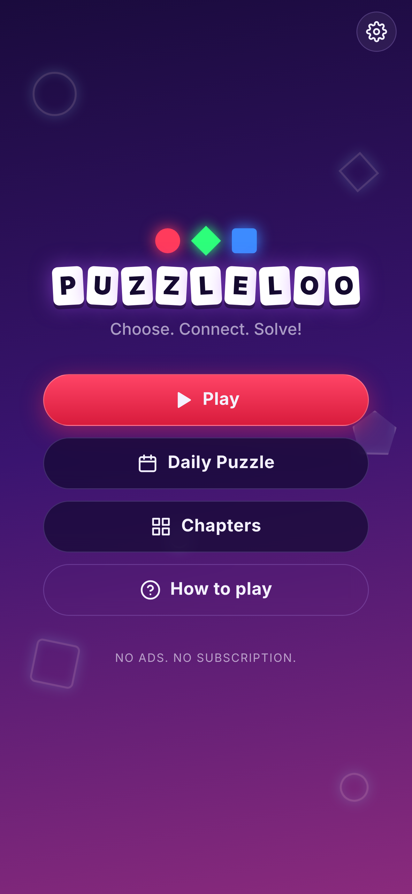
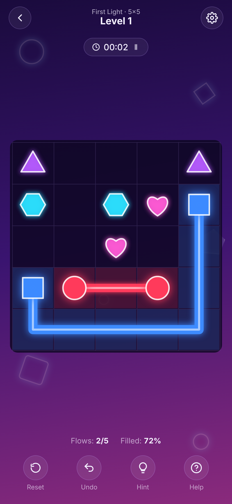
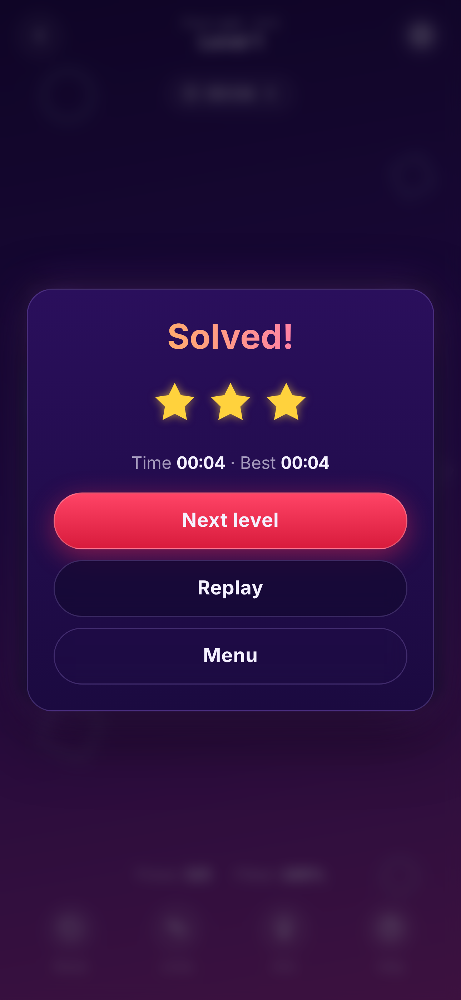

# PuzzleLoo 🧩

لعبة ألغاز «وصّل الأشكال» بأسلوب نيون: اسحب خطًا من كل شكل إلى توأمه، الخطوط لا تتقاطع، واملأ كل مربعات اللوحة.
A neon "connect the matching shapes" logic puzzle for iOS and Android.

<p align="center">  </p>

## المميزات / Features
- 5 فصول × 24 مرحلة = **120 مرحلة** (5×5 حتى 9×9)، ولغز يومي جديد كل يوم
- كل المراحل تُولَّد بشكل ثابت (seeded) ومضمونة الحل، والاختبارات تتحقق من كل مرحلة
- تلميح، تراجع، إعادة، مؤقّت، نجوم، حفظ تلقائي للتقدّم
- عربي/إنجليزي مع دعم RTL، صوت واهتزاز (Haptics)
- تعمل بدون إنترنت، بدون إعلانات، بدون جمع بيانات

## التشغيل / Development
```bash
npm install
npm run dev        # http://localhost:5173
npm test           # unit tests (logic + every level is solvable)
npm run build
```

## Structure
| Path | What |
|---|---|
| `src/game/generator.ts` | Level generator: random Hamiltonian path (backbite) cut into flows → always solvable & fully-filling |
| `src/game/board.ts` | Game rules: drawing, cutting other flows, undo, hint, win check |
| `src/game/renderer.ts` | Canvas neon renderer |
| `src/game/levels.ts` | Chapters, unlock rules, daily puzzle |
| `src/main.ts` | Screens (home, chapters, levels, game, dialogs) |
| `ios/`, `android/` | Native Capacitor projects |
| `store/` | Store listing text + screenshots |
| `public/privacy.html` | Privacy policy (required by both stores) |

## النشر على المتاجر / Publishing

> قبل النشر: غيّر `appId` في `capacitor.config.ts` (حاليًا `com.puzzleloo.app`) لمعرّف خاص فيك، مثل `com.yourname.puzzleloo`، وغيّره كذلك في `android/app/build.gradle` وفي Xcode (Bundle Identifier).

بعد أي تعديل على الكود:
```bash
npm run cap:sync     # build + copy to ios/ and android/
```

### Google Play (Android)
1. نزّل [Android Studio](https://developer.android.com/studio) ثم `npx cap open android`.
2. **Build → Generate Signed App Bundle → Android App Bundle**، وأنشئ keystore جديد (احتفظ فيه وبكلمة السر بمكان آمن، لأنك لن تستطيع تحديث التطبيق بدونه).
3. سجّل في [Google Play Console](https://play.google.com/console) (رسوم 25$ لمرة واحدة) ← Create app ← ارفع ملف `.aab`.
4. عبّئ معلومات المتجر من `store/listing.md`، وارفع الأيقونة `resources/icon.png` (بحجم 512×512) والصور من `store/screenshots/`، وFeature graphic بحجم 1024×500.
5. Data safety: «لا يتم جمع بيانات». وضع رابط سياسة الخصوصية.
6. حسابات المطوّرين الأفراد الجديدة تحتاج **اختبارًا مغلقًا مع 12 مختبِرًا لمدة 14 يومًا** قبل النشر للإنتاج.

### App Store (iOS)
1. تحتاج جهاز **Mac** مع Xcode، وعضوية [Apple Developer](https://developer.apple.com/programs/) (99$ سنويًا).
2. `npx cap open ios` ← اختر Team من Signing & Capabilities، وغيّر Bundle Identifier.
3. أنشئ التطبيق في [App Store Connect](https://appstoreconnect.apple.com) بنفس الـ Bundle ID.
4. في Xcode: **Product → Archive → Distribute App → App Store Connect**.
5. عبّئ الوصف والصور من `store/`، وفي App Privacy اختر «Data Not Collected»، ثم أرسل للمراجعة.

### استضافة سياسة الخصوصية
المتجران يطلبان رابطًا عامًا. أسهل طريقة: فعّل GitHub Pages على المستودع وضع رابط `.../privacy.html`.

## Assets
- `npm run icons` يعيد إنشاء `resources/icon.png` و `splash.png` من `public/icon.svg` (يحتاج Playwright)
- `npm run cap:assets` يولّد كل أحجام الأيقونات وشاشات البداية لـ iOS و Android

## Legal note
PuzzleLoo is an original implementation of the classic "connect the pairs / fill the grid" puzzle genre. Don't use other companies' names, logos or artwork (e.g. Netflix) in the app or store listing.
